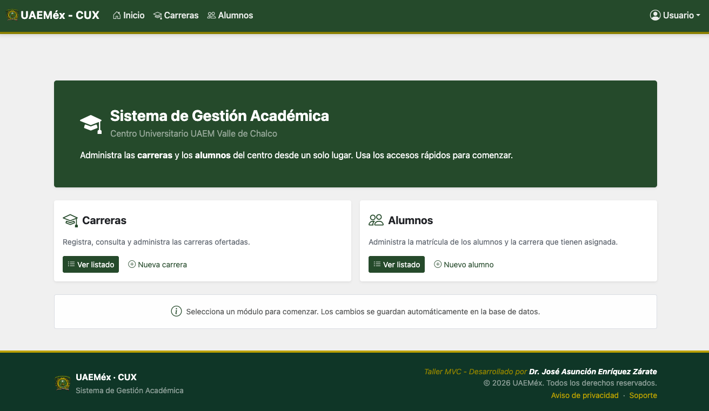
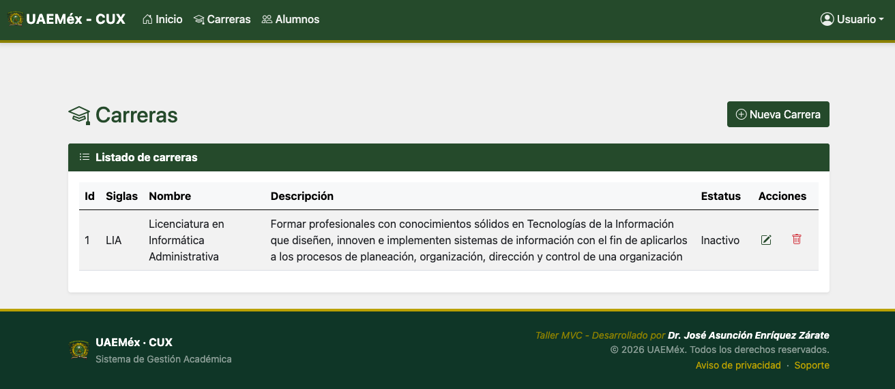
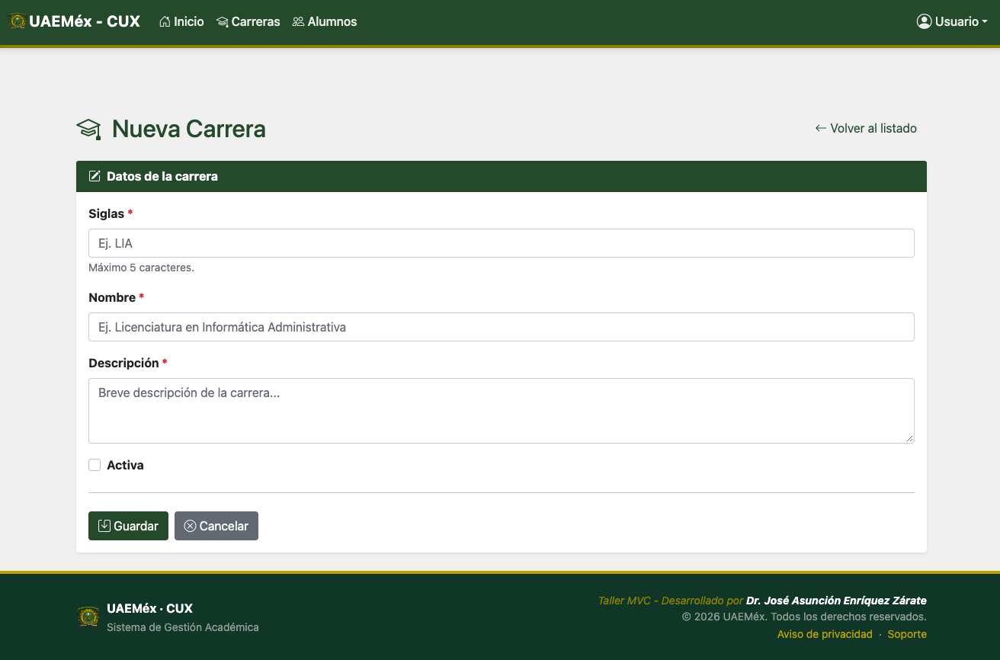
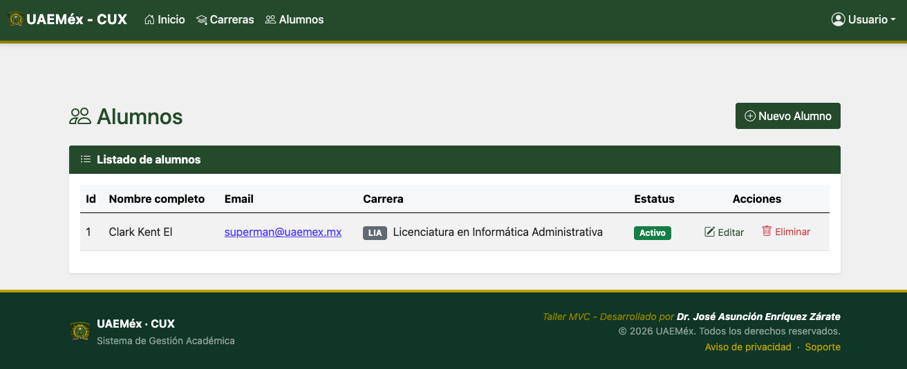
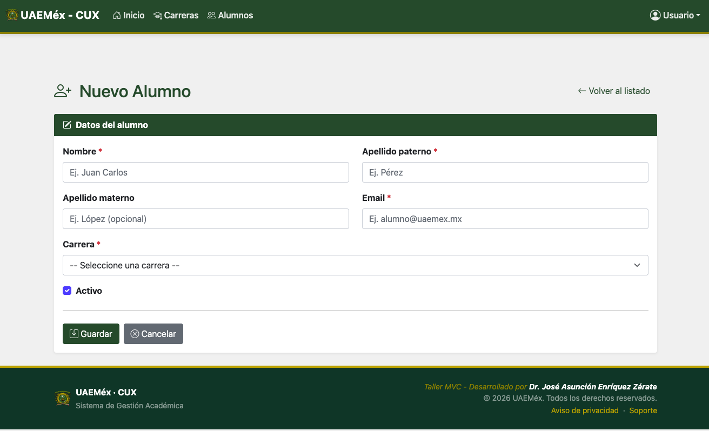

# 🎓 Sistema de Gestión Académica - UAEMéx CUX


Aplicación web desarrollada para la administración de carreras y alumnos del **Centro Universitario UAEM Valle de Chalco (CUX)**. Este proyecto permite registrar, consultar, actualizar y dar de baja información académica desde un panel centralizado, con un diseño moderno, responsivo e intuitivo.

---

## 🛠️ Tecnologías Utilizadas

El proyecto fue construido utilizando el ecosistema de **Spring** y las siguientes herramientas:

| Tecnología | Descripción |
| :--- | :--- |
| **Java** | Lenguaje de programación base (v17+ recomendado). |
| **Spring Boot** | Framework principal para el desarrollo rápido de la aplicación. |
| **Spring Web (MVC)** | Implementación del patrón Modelo-Vista-Controlador para el manejo de rutas y peticiones. |
| **Spring Data JPA** | Abstracción de la capa de persistencia para interactuar con la base de datos. |
| **Thymeleaf** | Motor de plantillas del lado del servidor para renderizar las vistas HTML. |
| **MySQL** | Sistema de gestión de bases de datos relacional. |
| **Lombok** | Librería para reducir el código *boilerplate* (Getters, Setters, Constructores). |
| **Spring DevTools** | Herramientas de desarrollo para recarga automática de la aplicación. |

---

## 📸 Capturas de Pantalla

### Pantalla de Inicio
*Panel principal con accesos rápidos a los módulos del sistema.*


### Módulo de Carreras
| Listado de Carreras | Registro de Nueva Carrera |
| :---: | :---: |
|  |  |

### Módulo de Alumnos
|    Listado de Alumnos     | Registro de Nuevo Alumno |
|:-------------------------:| :---: |
|  |  |

---

## ✨ Características Principales

*   **CRUD Completo:** Gestión integral (Crear, Leer, Actualizar, Eliminar) para las entidades de `Carrera` y `Alumno`.
*   **Validación de Formularios:** Uso de validaciones en el backend para asegurar la integridad de los datos (campos obligatorios, formatos de correo, etc.).
*   **Relaciones de Base de Datos:** Asociación de Alumnos a Carreras mediante llaves foráneas manejadas con JPA.
*   **Manejo de Estados:** Gestión de estados lógicos (Activo/Inactivo) para carreras y alumnos.
*   **Interfaz de Usuario (UI):** Diseño limpio y responsivo basado en los colores institucionales de la UAEMéx.

---

## ⚙️ Requisitos Previos

Antes de ejecutar el proyecto, asegúrate de tener instalado:
*   [Java JDK](https://www.oracle.com/java/technologies/downloads/) (Versión 17 o superior)
*   [Maven](https://maven.apache.org/download.cgi) (O usar el wrapper incluido `./mvnw`)
*   [MySQL](https://dev.mysql.com/downloads/installer/) (Versión 8.0 o superior)
*   Un IDE de tu preferencia (IntelliJ IDEA, Eclipse, VS Code)

---

## 🚀 Instalación y Ejecución Local

Sigue estos pasos para correr el proyecto en tu máquina:

**1. Clona el repositorio:**
```bash
git clone https://github.com/tu-usuario/tu-repositorio.git
cd tu-repositorio